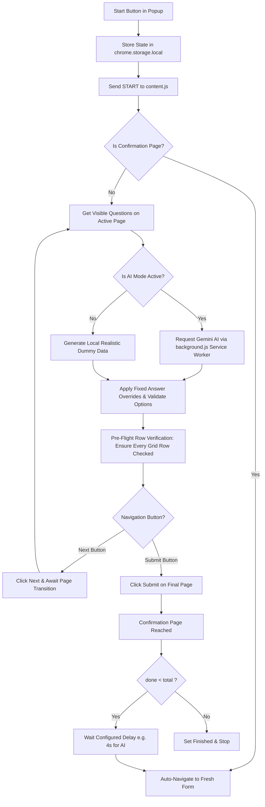

<div align="center">

# 📋 FormPilot: Google Forms Auto-Filler & AI Testing Engine

**A high-performance Chrome Extension (Manifest V3) to automate filling and submitting Google Forms with Gemini AI answers, realistic dummy personas, or custom fixed rules across 1 to 50+ pages.**

[](https://developer.chrome.com/docs/extensions/mv3/intro/)
[](https://aistudio.google.com/)
[](https://opensource.org/licenses/MIT)
[](#multi-page-form-navigation)
[-brightgreen)](#security--privacy)
[](#security--privacy)

[Key Features](#key-features) • [Gemini AI Mode](#-gemini-ai-answering-mode) • [Installation](#installation) • [How to Use & Test](#-how-to-use--test) • [Fixed Answers & Bulk Rules](#fixed-answers--bulk-rules) • [Architecture](#architecture--technical-deep-dive) • [Troubleshooting](#troubleshooting)

</div>

---

## 🌟 Overview

Testing complex Google Forms—especially academic research surveys, product evaluations, and multi-page questionnaires spanning 40+ sections—is tedious when done manually.

**FormPilot** is built specifically for form creators, researchers, QA engineers, and developers who need to stress-test their forms across dozens of pages and generate realistic survey responses with a single click.

Choose between two powerful execution modes:
1. **🤖 Gemini AI Mode**: Uses Google's Gemini API to analyze question titles and options, answering with human-like, persona-consistent survey responses.
2. **🎲 Random Dummy Mode**: Operates 100% locally with high-variety Indian personas, addresses, ratings, and contextual sentences with zero API calls.

---

## ✨ Key Features

- **🤖 Google Gemini AI Mode**:
  - Automatically queries Google's Gemini API (`gemini-2.5-flash` or custom model) with full page context in **one batch request** per page.
  - Dynamically synthesizes coherent respondent personas (age, Indian city, occupation, gender, education) with support for custom **Persona Hints** (e.g. *"college students in Pune"*).
  - Validates AI responses against form options with automatic fallback to random choices if unrecognized.
- **🚀 1 to 50+ Multi-Page Navigation**:
  - Navigates through multi-section forms by advancing through **"Next"** buttons, validating required questions on each page, and submitting on the final page.
- **📊 Full Checkbox & Multiple-Choice Grid Support**:
  - Detects and answers every single row in matrix questions (including Semantic Differential grids, 1–5 scales, and multi-row rating tables) without leaving rows empty.
- **🎯 Fixed Answers Override**:
  - Map specific question keywords to exact answers (e.g., `resident` $\to$ `Yes`, `rating` $\to$ `5`). Fixed answers **always strictly override** AI and random answers.
- **📋 Bulk Rules Editor & Page Scanner**:
  - Paste dozens of question rules at once using simple `keyword : answer` syntax or scan the active form page directly into the rules table.
- **🔄 Batch Submissions with Auto-Loop**:
  - Specify how many responses to submit (e.g. 10 responses). The extension automatically submits, waits a rate-limit safe delay (default 4s for AI), re-navigates to a fresh form, and begins the next response.
- **🛡️ Unstoppable Self-Healing Watchdog**:
  - A 2-second background watchdog actively monitors form progress. If network lag or Google Forms validation pauses the page, it self-heals missing fields and continues automatically.
- **⚙️ Secure Options Page**:
  - Dedicated credentials settings page. Keys are stored safely in `chrome.storage.local` with masked password inputs. Zero hardcoding, logging, or leaks.

---

## 🤖 Gemini AI Answering Mode

### 1. Obtain a Free Gemini API Key
1. Visit [Google AI Studio](https://aistudio.google.com/app/apikey).
2. Sign in with your Google account.
3. Click **"Create API key"** and copy the generated key.

> [!NOTE]
> **Free Tier Privacy Disclosure**: Under Google AI Studio's free tier, prompts and responses may be processed and reviewed by human reviewers to train and improve Google products. **Never submit real, confidential, proprietary, or personally identifiable data (PII).**

> [!WARNING]
> **Ethical & Authorized Testing Only**: Use FormPilot and AI mode **ONLY on your own forms** or forms where you have explicit authorization to conduct testing. Never use automated tools to spam or submit unauthorized responses.

### 2. Configure Settings in Extension
1. Click the **FormPilot** extension icon in your Chrome toolbar.
2. Click the **⚙️ Settings** button at the top of the popup (or right-click the extension icon and select **Options**).
3. Paste your Gemini API key.
4. Leave the model name as `gemini-2.5-flash` (or choose another model like `gemini-1.5-flash`).
5. Click **"Test Key"** to verify that your key is valid and connected.
6. Click **"Save Settings"**.

---

## 🏗️ Architecture & Workflow



---

## 📦 Installation

This extension is loaded as an unpacked developer extension in Google Chrome, Brave, Microsoft Edge, or any Chromium-based browser:

1. **Clone the repository**:
   ```bash
   git clone https://github.com/makdi-manav/FormPilot.git
   cd FormPilot
   ```

2. **Open Extensions in Chrome**:
   Navigate to:
   ```text
   chrome://extensions
   ```

3. **Enable Developer Mode**:
   Toggle the **Developer mode** switch in the top-right corner.

4. **Load Unpacked**:
   - Click the **Load unpacked** button in the top-left toolbar.
   - Select the `form-filler-extension` folder inside this repository:
     ```text
     /path/to/FormPilot/form-filler-extension
     ```

5. *(When updating code)* Click the **reload (↻)** icon on the FormPilot card in `chrome://extensions`.

---

## 🧪 How to Use & Test

### Phase 1: Test with 2 Responses First
Before starting a large batch, run a 2-response test to ensure the form advances and submits properly:

1. Open your target Google Form:
   ```text
   https://docs.google.com/forms/d/e/.../viewform
   ```
2. Open Chrome DevTools Console: Press <kbd>F12</kbd> (or <kbd>Ctrl</kbd>+<kbd>Shift</kbd>+<kbd>I</kbd>) and click **Console**.
3. Open the **FormPilot** popup:
   - Toggle **"Use AI answers (Gemini)"** to **ON**.
   - *(Optional)* Add a **Persona hint** (e.g. *"college students in Pune"*).
   - Set **"How many responses"** to `2`.
   - Set **Delay** to `4` seconds (helps avoid API rate limits).
4. Click **▶ Start Filling**.
5. Observe the live execution:
   - FormPilot extracts questions, requests AI answers via background service worker, populates all visible fields, and clicks **Next**.
   - Once the final page is submitted, it waits 4s, refreshes to a fresh form, and submits Response 2 with a fresh persona.
   - Popup displays `Finished (2 / 2)`.

### Phase 2: Batch Submit 10 Responses
Once the 2-response test passes:
1. Open the popup.
2. Set **"How many responses"** to `10`.
3. Click **▶ Start Filling**.
4. FormPilot will handle all 10 submissions autonomously. If Gemini returns an HTTP 429 rate limit, FormPilot pauses for 20 seconds and retries up to 3 times automatically.

---

## 📋 Supported Question Types

| Question Type | Selector / Detection | AI Mode Behavior | Fallback / Random Mode |
| :--- | :--- | :--- | :--- |
| **Short Answer** | `input[type="text"]`, `email`, `tel`, `number` | Natural short text matching respondent persona | Indian persona generator (Name, City, etc.) |
| **Paragraph** | `textarea` | Cohesive opinion / feedback matching persona | Contextual dummy feedback sentences |
| **Multiple Choice** | `div[role="radio"]` | Matches option verbatim from Gemini | Random standard option |
| **Checkboxes** | `div[role="checkbox"]` | Checks multiple options returned in AI array | Random 1–3 checkboxes |
| **Dropdown** | `div[role="listbox"]`, native `<select>` | Matches option text case-insensitively | Random valid option |
| **Linear Scale** | `role="radiogroup"` (1–5 or 1–10) | Matches numeric score from Gemini | Random rating |
| **Multiple-Choice Grid** | Table rows with `role="radio"` | Solves each row as individual sub-question | Random option in every row |
| **Checkbox Grid** | Table rows with `role="checkbox"` | Solves each row with checkbox selections | Random checkbox in every row |
| **Date & Time** | `input[type="date"]`, `time`, split text fields | Valid ISO date and HH:MM time strings | Random valid date (1980–2025) and time |
| **File Upload** | `input[type="file"]`, upload cards | **Skipped & logged** (browser sandbox security) | **Skipped & logged** |

---

## 🎯 Fixed Answers & Bulk Rules

Fixed answers allow you to pin specific responses regardless of whether AI Mode or Random Mode is active.

### Example Rules
```text
resident -> Yes
age -> 24
department -> Research and Development
overall satisfaction -> Very Satisfied
```

### Methods to Configure:
1. **Popup Table**: Add and edit keyword $\to$ answer rows directly in the popup.
2. **📋 Bulk Edit**: Paste dozens of rules at once in `keyword : answer` format.
3. **🔍 Scan Page**: Automatically extracts question titles from the active tab and populates them into the table.

---

## 🔬 Architecture & Technical Deep Dive

### 1. Isolated Background Worker for AI Requests
To adhere to Chrome's strict Manifest V3 Content Security Policy (CSP), the content script **never makes network requests directly**. Instead, it parses question elements and sends them to `background.js` via `chrome.runtime.sendMessage`. The service worker handles the Google Generative Language API call with authenticated headers (`x-goog-api-key`) and returns validated JSON answers.

### 2. Multi-Signal Page Transition Detector
On multi-page questionnaires where questions across sections have identical titles, the transition engine checks:
1. Progress bar counter text (`Page X of 43`).
2. Unique Coaster / section image codes (`S01`, `S02`, ... `S40`).
3. Appearance of the final **"Submit"** button.
4. Mutation of active DOM listitems.

### 3. Bulletproof Grid & Table Handler
The extension identifies matrix grid questions through two tiers:
1. Container inspection (`role="row"`, `role="radiogroup"`, `role="group"`) with option-ownership deduplication.
2. Vertical position clustering grouping elements within 18px vertical tolerance.
3. Pre-flight verification (`ensurePageCompletelyFilled`) iterates every row and ensures `aria-checked="true"` before advancing.

---

## 🛠️ Project Structure

```text
FormPilot/
├── .github/
│   ├── workflows/
│   │   └── ci.yml               # GitHub Actions CI for manifest & syntax validation
│   └── ISSUE_TEMPLATE/
│       ├── bug_report.md        # Standardized bug reporting template
│       └── feature_request.md   # Standardized feature request template
├── form-filler-extension/       # Chrome Extension Root (Load this folder in Chrome)
│   ├── icons/
│   │   ├── icon16.png
│   │   ├── icon48.png
│   │   └── icon128.png
│   ├── background.js            # Service worker handling Gemini API & rate-limiting
│   ├── content.js               # Form filler, question scanner, DOM observer & navigation
│   ├── manifest.json            # Manifest V3 specification, permissions & options page
│   ├── options.html             # Dedicated credentials settings page
│   ├── options.css              # Options page styling
│   ├── options.js               # API key validation, testing, and secure local storage
│   ├── popup.css                # Modern popup stylesheet
│   ├── popup.html               # Popup UI markup (AI toggle, persona hint, bulk editor)
│   ├── popup.js                 # Popup state management and message dispatcher
│   └── README.md                # Extension-specific quick reference & guide
├── .gitignore                   # Comprehensive gitignore (.env, *.key, OS files)
├── CONTRIBUTING.md              # Guidelines for open-source contributors
├── LICENSE                      # MIT Open Source License
└── README.md                    # Main repository documentation
```

---

## ❓ Troubleshooting

### 1. "Invalid API key" or AI mode fails to start
- **Cause**: The API key is missing or invalid.
- **Fix**: Open **⚙️ Settings**, paste a valid key from [Google AI Studio](https://aistudio.google.com/app/apikey), and click **"Test Key"**.

### 2. HTTP 429 Rate Limit Encountered
- **Cause**: Google Generative AI free-tier rate limits reached (15 RPM on free tier).
- **Fix**: The extension will automatically pause for 20 seconds and retry up to 3 times. For large batches, increase the submission delay in the popup to `5`–`8` seconds.

### 3. "Could not establish connection. Receiving end does not exist"
- **Cause**: The extension was updated or reloaded in `chrome://extensions` while the Google Form tab was still open on an older injection.
- **Fix**: Refresh the Google Form tab (<kbd>Ctrl</kbd>+<kbd>R</kbd> or <kbd>F5</kbd>) and click **Start**.

### 4. File upload questions are skipped
- **Notice**: Chromium security policies prevent browser extensions from programmatically uploading arbitrary local files to native OS file picker dialogs. File upload questions are intentionally skipped and logged.

---

## 🛡️ Security & Privacy

- **No Remote Code Execution**: All extension code is packaged locally (Manifest V3).
- **Strict Host Permissions**: Host permissions are limited strictly to `https://docs.google.com/forms/*` and `https://generativelanguage.googleapis.com/*`.
- **Zero Third-Party Telemetry**: No analytics, tracking pixels, or external dependencies.
- **Local Key Storage**: API keys are saved exclusively in your browser's encrypted `chrome.storage.local` and never transmitted anywhere except Google's official Gemini endpoint.

---

## 📄 License

This project is open-source software licensed under the [MIT License](LICENSE).  
Copyright © 2026 makdi-manav.
