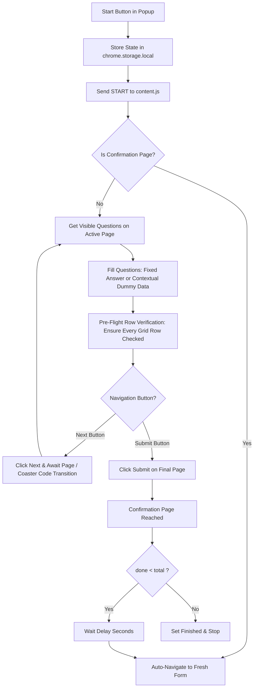

<div align="center">

# 📋 Google Forms Auto-Filler & Multi-Page Testing Engine

**A high-performance Chrome Extension (Manifest V3) to automate filling and submitting Google Forms with realistic dummy data or custom fixed answers.**

[](https://developer.chrome.com/docs/extensions/mv3/intro/)
[](https://opensource.org/licenses/MIT)
[](#multi-page-form-navigation)
[-brightgreen)](#security--privacy)
[](#security--privacy)

[Key Features](#key-features) • [Installation](#installation) • [How to Use](#how-to-use) • [Fixed Answers & Bulk Rules](#fixed-answers--bulk-rules) • [Architecture](#architecture--technical-deep-dive) • [Troubleshooting](#troubleshooting)

</div>

---

## 🌟 Overview

Testing complex Google Forms—especially academic research surveys, product evaluations, and multi-page questionnaires spanning 40+ sections—is tedious when done manually.

**Google Forms Auto-Filler** is built specifically for form creators, researchers, QA engineers, and developers who need to stress-test their forms across dozens of pages and generate multiple realistic survey responses with a single click.

It is **100% client-side**, runs locally in your browser, contains **zero external dependencies**, and does **not transmit any telemetry or network requests**.

---

## ✨ Key Features

- **🚀 1 to 50+ Multi-Page Navigation**:
  Effortlessly navigates through complex multi-section forms by advancing through **"Next"** buttons, validating required questions on each page, and submitting on the final page.
- **📊 Full Checkbox & Multiple-Choice Grid Support**:
  Detects and answers every single row in matrix questions (including Semantic Differential grids, 1–5 scales, and multi-row rating tables) without leaving rows empty.
- **🧠 Realistic Contextual Data Generation**:
  Generates cohesive personas with realistic Indian demographics:
  - First & Last Names, custom email IDs (`firstname.lastname@example.com`)
  - Valid age ranges ($18–60$), 10-digit mobile numbers starting with 6/7/8/9
  - Real Indian cities, states, 6-digit postal PIN codes, and street addresses
  - Contextual feedback and justification sentences for open-ended text fields.
- **🎯 Fixed Answers & Specific Rules Editor**:
  Map specific question keywords to exact answers (e.g., `resident` $\to$ `Yes`, `rating` $\to$ `5`).
- **📋 Bulk Rules Editor**:
  Paste dozens of question rules at once using simple `keyword : answer` syntax.
- **🔍 Scan Page Questions**:
  Inspects the active form page and imports question titles directly into the rules editor with one click.
- **🔄 Multi-Submission Loop with Auto-Restart**:
  Specify how many responses to submit (e.g. 10 responses). The extension automatically submits, waits your configured delay, re-navigates to a fresh form, and begins the next response without requiring page refreshes.
- **🛡️ Unstoppable Self-Healing Watchdog**:
  A 2-second background watchdog actively monitors form progress and DOM transitions. If network lag or Google Forms validation pauses the page, it self-heals missing fields and continues automatically.
- **🔒 Pure Manifest V3 Compliance**:
  Uses `chrome.storage.local` and background service workers; host permissions are strictly scoped to `https://docs.google.com/forms/*`.

---

## 🏗️ Architecture & Workflow



---

## 📦 Installation

This extension is loaded as an unpacked developer extension in Google Chrome, Brave, Microsoft Edge, or any Chromium-based browser:

1. **Clone the repository**:
   ```bash
   git clone https://github.com/makdi-manav/FormPilot.git
   cd FormPilot
   ```

2. **Open Extensions in Chrome**:
   Navigate to:
   ```text
   chrome://extensions
   ```

3. **Enable Developer Mode**:
   Toggle the **Developer mode** switch in the top-right corner.

4. **Load Unpacked**:
   - Click the **Load unpacked** button in the top-left toolbar.
   - Select the **`form-filler-extension`** directory inside this repository:
     ```text
     /path/to/FormPilot/form-filler-extension
     ```

5. **Pin Extension**:
   Click the puzzle piece icon in the Chrome toolbar and pin **Google Forms Auto-Filler** for easy access.

---

## 🚀 How to Use

### Basic Automated Test
1. Open your target Google Form in Chrome (e.g., `https://docs.google.com/forms/d/e/.../viewform`).
2. Click the **Google Forms Auto-Filler** icon in your browser toolbar.
3. Set your desired settings:
   - **How many responses**: e.g., `10`
   - **Delay between submissions**: e.g., `2` seconds
4. Click **▶ Start Filling**.
5. Watch the extension automatically fill, validate, advance across all pages, and submit!

---

## 📝 Fixed Answers & Bulk Rules

If your form requires specific answers rather than random dummy data, configure rules using any of these 3 methods:

### Method 1: Bulk Edit (Fastest for Multi-Page Forms)
Click **📋 Bulk Edit** in the popup and paste your rules in `keyword : answer` format:

```text
resident : Yes
coaster : 4
decoration : Traditional — Contemporary
style : Minimal
satisfaction : Highly Satisfied
feedback : The user interface is intuitive and clear.
```

Click **Apply Bulk Rules**. Any question title containing the keyword (case-insensitive) will receive that exact answer.

### Method 2: Scan Active Page Questions
1. Open your Google Form in the active tab.
2. Open the extension popup and click **🔍 Scan Page**.
3. All question titles currently visible on the active page are instantly imported into your rules table. Fill in your preferred answers.

### Method 3: Strict Mode Toggle
- **Checked (Default)**: Questions matching your keywords use your specific answers; all other questions receive realistic random data.
- **Unchecked (Strict Mode)**: Only questions matching your keyword rules are answered. Unmapped questions are left untouched.

---

## 📋 Supported Question Types

| Question Type | Selector / Detection | Automation Strategy |
| :--- | :--- | :--- |
| **Short Answer** | `input[type="text"]`, `email`, `tel`, `number` | Contextual text based on title keywords (name, age, city, etc.) |
| **Paragraph** | `textarea` | Generates realistic sentences or uses custom text rules |
| **Multiple Choice** | `div[role="radio"]` | Selects matching fixed option or picks a random standard choice |
| **Checkboxes** | `div[role="checkbox"]` | Picks 1–3 random options, or comma-separated fixed items (`A, B`) |
| **Dropdown** | `div[role="listbox"]`, native `<select>` | Opens menu and selects random or matched option |
| **Linear Scale** | `role="radiogroup"` (1–5 or 1–10) | Selects a numeric rating |
| **Multiple-Choice Grid** | Table rows with `role="radio"` | **Guarantees an option is selected in every single row** |
| **Checkbox Grid** | Table rows with `role="checkbox"` | **Guarantees at least one checkbox is checked in every row** |
| **Date & Time** | `input[type="date"]`, `time`, split text fields | Generates valid dates (1980–2025) and times |
| **File Upload** | `input[type="file"]`, upload cards | Safely skipped and logged (browser security restricts file automation) |

---

## 🔬 Architecture & Technical Deep Dive

### 1. Self-Healing Row Verification
Google Forms rejects submissions if any row in a matrix question is left blank (*"This question requires at least one response per row"*). The extension employs [`ensurePageCompletelyFilled()`](form-filler-extension/content.js):
- Gathers both container-based rows (`role="group"`, `role="radiogroup"`, `role="row"`) and groups options by document vertical Y-coordinates.
- Verifies `aria-checked="true"` on every row. If any row is missing a response, it immediately selects an option and verifies state before clicking **Next**.

### 2. Multi-Signal Page Transition Detector
On multi-page questionnaires where questions across sections have identical titles, the transition engine checks:
1. Progress bar counter text (`Page X of 43`).
2. Unique Coaster / section image codes (`S01`, `S02`, ... `S40`).
3. Appearance of the final **"Submit"** button.
4. Mutation of active DOM listitems.

### 3. Direct Location Navigation
Rather than relying on synthetic `.click()` events on anchor tags (which Chromium security often ignores without user gesture), the extension uses direct `window.location.href` assignments to transition seamlessly between form submissions.

### 4. Background Watchdog Timer
A 2-second interval watchdog runs alongside the event listener. If a page transition lags or Google Forms client-side hydration pauses, the watchdog automatically resumes processing without requiring the user to refresh the page.

---

## 🛠️ Project Structure

```text
FormPilot/
├── .github/
│   ├── workflows/
│   │   └── ci.yml               # GitHub Actions CI for manifest & syntax validation
│   └── ISSUE_TEMPLATE/
│       ├── bug_report.md        # Standardized bug reporting template
│       └── feature_request.md   # Standardized feature request template
├── form-filler-extension/       # Chrome Extension Root (Load this folder in Chrome)
│   ├── icons/
│   │   ├── icon16.png
│   │   ├── icon48.png
│   │   └── icon128.png
│   ├── background.js            # Service worker initializing default settings
│   ├── content.js               # Core form filler, DOM observer & navigation engine
│   ├── manifest.json            # Manifest V3 specification & permissions
│   ├── popup.css                # Clean, modern extension popup styling
│   ├── popup.html               # Popup UI markup (rules table, bulk editor, progress)
│   ├── popup.js                 # Popup logic, rule persistence, message dispatcher
│   └── README.md                # Extension-specific quick reference
├── .gitignore                   # Comprehensive gitignore for OS, IDE & build files
├── CONTRIBUTING.md              # Guidelines for open-source contributors
├── LICENSE                      # MIT Open Source License
└── README.md                    # Main repository documentation
```

---

## ❓ Troubleshooting

### 1. The form stops advancing or shows `ERR_BLOCKED_BY_CLIENT`
- **Cause**: Content blockers or privacy extensions (e.g., uBlock Origin, AdBlock Plus) can intercept Google Forms' internal background `POST /formResponse` draft-saving requests.
- **Fix**: Click your ad blocker icon in Chrome and **pause / whitelist `docs.google.com`**.

### 2. "Could not establish connection. Receiving end does not exist"
- **Cause**: The extension was updated or reloaded in `chrome://extensions` while the Google Form tab was still open on an older injection.
- **Fix**: Refresh the Google Form tab (`Ctrl+R` or `F5`) and click **Start**.

### 3. File upload questions are skipped
- **Notice**: Chromium security policies prevent browser extensions from programmatically uploading arbitrary local files to native OS file picker dialogs. File upload questions are intentionally skipped and logged.

---

## 🛡️ Security & Privacy

- **No Remote Code Execution**: All code runs strictly within your browser.
- **No External Analytics**: No tracking pixels, Google Analytics, or third-party SDKs.
- **Strict Host Permissions**: Host permissions are limited strictly to `https://docs.google.com/forms/*`.
- **Zero Dependencies**: Hand-crafted with vanilla JavaScript, modern Web APIs, and standard CSS.

---

## 📄 License

This project is open-source software licensed under the [MIT License](LICENSE).  
Copyright © 2026 Sumiraj Saroj.
