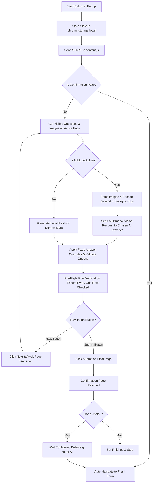

<div align="center">

# 📋 FormPilot: Universal AI Google Forms Auto-Filler & Testing Engine

**A high-performance Chrome Extension (Manifest V3) to automate filling and submitting Google Forms with ANY AI Model (Gemini, OpenAI, Claude, OpenRouter, Groq, Ollama), multimodal vision, realistic respondent personas, or custom fixed rules across 1 to 50+ pages.**

[](https://developer.chrome.com/docs/extensions/mv3/intro/)
[](https://openrouter.ai/)
[](https://opensource.org/licenses/MIT)
[](#multi-page-form-navigation)
[-brightgreen)](#security--privacy)
[](#security--privacy)

[Key Features](#key-features) • [Universal AI Configuration](#-universal-ai-configuration) • [Installation](#installation) • [How to Use & Test](#-how-to-use--test) • [Fixed Answers & Bulk Rules](#fixed-answers--bulk-rules) • [Architecture](#architecture--technical-deep-dive) • [Troubleshooting](#troubleshooting)

</div>

---

## 🌟 Overview

Testing complex Google Forms—especially academic research surveys, product evaluations, and multi-page questionnaires spanning 40+ sections—is tedious when done manually.

**FormPilot** is built specifically for form creators, researchers, QA engineers, and developers who need to stress-test their forms across dozens of pages and generate realistic survey responses with a single click.

Choose between two powerful execution modes:
1. **🤖 Universal Vision AI Mode**: Connect **ANY AI Model** using your API key (Google Gemini, OpenAI GPT-4o, Anthropic Claude 3.5 Sonnet, OpenRouter, Groq, DeepSeek, or local Ollama). FormPilot inspects product images and diagrams on the form and answers with visually grounded, human-like responses across 4 varied writing styles.
2. **🎲 Random Dummy Mode**: Operates 100% locally with high-variety Indian personas, addresses, ratings, and contextual sentences with zero API calls.

---

## ✨ Key Features

- **🌐 Universal AI Provider Support**:
  - **Google Gemini**: `gemini-2.5-flash`, `gemini-2.5-pro`, `gemini-2.0-flash`.
  - **OpenAI**: `gpt-4o`, `gpt-4o-mini`, `gpt-4-turbo`, `o1`, `o3-mini`.
  - **Anthropic Claude**: `claude-3-5-sonnet-20241022`, `claude-3-5-haiku-20241022`, `claude-3-opus`.
  - **OpenRouter**: Access 200+ models with one key (Claude, Llama 3, DeepSeek, Qwen).
  - **Groq**: Ultra-fast vision inference (`llama-3.2-11b-vision-preview`, `llama-3.2-90b-vision-preview`).
  - **Custom / Local**: DeepSeek (`api.deepseek.com`), Ollama (`localhost:11434`), Together AI, vLLM, LM Studio.
- **👁️ Multimodal Vision Support Across All Providers**:
  - Automatically identifies stimulus images (product designs, diagrams, and question-embedded photos) on each section.
  - Converts images into base64 payloads and formats them into the native vision schema of your chosen provider.
  - Makes one targeted AI call per section/stimulus to maintain clean visual context.
- **🎛️ Dynamic Model Selector & Temperature Slider**:
  - Automatically fetches live available models from your provider catalog, or allows typing any custom model identifier.
  - Interactive **Temperature Slider** (0.0 to 1.5, default 1.0) with real-time value display.
- **🎭 4 Diverse Writing Styles & Anti-Duplicate Engine**:
  - Synthesizes realistic Indian demographics (age, city, occupation, education, income, tech comfort).
  - Assigns respondents to distinct writing styles:
    - **Terse** (~35%): 3–8 words only, direct, concise.
    - **Casual** (~30%): lowercase, conversational, informal phrasing, minor typos.
    - **Average** (~25%): one plain, everyday sentence.
    - **Detailed** (~10%): 2–3 sentences with concrete observations.
  - Skips optional questions about 20% of the time to match real participant behavior.
  - **Cross-Section Memory**: Remembers earlier answers within the same submission to maintain taste and opinion consistency across sections.
  - **Run-Wide Deduplication**: Detects identical open-ended answers across respondents and prompts the AI for a unique rewrite.
- **🚀 1 to 50+ Multi-Page Navigation**:
  - Navigates through multi-section forms by advancing through **"Next"** buttons, validating required questions on each page, and submitting on the final page.
- **📊 Full Checkbox & Multiple-Choice Grid Support**:
  - Detects and answers every single row in matrix questions (including Semantic Differential grids, 1–5 scales, and multi-row rating tables) without leaving rows empty.
- **🎯 Fixed Answers Override**:
  - Map specific question keywords to exact answers (e.g., `resident` $\to$ `Yes`, `rating` $\to$ `5`). Fixed answers **always strictly override** AI and random answers.
- **🔄 Batch Submissions with Auto-Loop**:
  - Specify how many responses to submit (e.g. 10 responses). The extension automatically submits, waits a rate-limit safe delay (default 4s for AI), re-navigates to a fresh form, and begins the next response.
- **🛡️ Unstoppable Self-Healing Watchdog**:
  - A 2-second background watchdog actively monitors form progress. If network lag or Google Forms validation pauses the page, it self-heals missing fields and continues automatically.

---

## 🤖 Universal AI Configuration

1. Click the **FormPilot** extension icon in your Chrome toolbar.
2. Click **⚙️ Settings** (or right-click the extension $\to$ **Options**).
3. Select your **AI Service Provider**:
   | Provider | Recommended Vision Model | How to Get an API Key |
   | :--- | :--- | :--- |
   | **Google Gemini** | `gemini-2.5-flash` | [Google AI Studio](https://aistudio.google.com/app/apikey) |
   | **OpenAI** | `gpt-4o-mini` / `gpt-4o` | [OpenAI Platform](https://platform.openai.com/api-keys) |
   | **Anthropic Claude** | `claude-3-5-sonnet-20241022` | [Anthropic Console](https://console.anthropic.com/settings/keys) |
   | **OpenRouter** | `google/gemini-2.5-flash` / `openai/gpt-4o` | [OpenRouter](https://openrouter.ai/keys) |
   | **Groq** | `llama-3.2-11b-vision-preview` | [Groq Console](https://console.groq.com/keys) |
   | **Custom / Local** | `deepseek-chat` / `llama3.2-vision` | Enter endpoint e.g. `http://localhost:11434/v1` |
4. Paste your API key, select or type your model, and click **"⚡ Test Connection"**.
5. Click **"💾 Save Settings"**.

---

## 🏗️ Architecture & Workflow



---

## 📦 Installation

This extension is loaded as an unpacked developer extension in Google Chrome, Brave, Microsoft Edge, or any Chromium-based browser:

1. **Clone the repository**:
   ```bash
   git clone https://github.com/makdi-manav/FormPilot.git
   cd FormPilot
   ```

2. **Open Extensions in Chrome**:
   Navigate to:
   ```text
   chrome://extensions
   ```

3. **Enable Developer Mode**:
   Toggle the **Developer mode** switch in the top-right corner.

4. **Load Unpacked**:
   - Click the **Load unpacked** button in the top-left toolbar.
   - Select the `form-filler-extension` folder inside this repository:
     ```text
     /path/to/FormPilot/form-filler-extension
     ```

5. *(When updating code)* Click the **reload (↻)** icon on the FormPilot card in `chrome://extensions`.

---

## 🧪 How to Use & Test

1. Open your target Google Form:
   ```text
   https://docs.google.com/forms/d/e/.../viewform
   ```
2. Open Chrome DevTools Console: Press <kbd>F12</kbd> (or <kbd>Ctrl</kbd>+<kbd>Shift</kbd>+<kbd>I</kbd>) and click **Console**.
3. Open the **FormPilot** popup:
   - Toggle **"Use AI answers"** to **ON**.
   - Notice the badge displays your active provider (e.g. `OPENAI`, `GEMINI`, `ANTHROPIC`, `GROQ`).
   - *(Optional)* Add a **Persona hint** (e.g. *"college students in Pune"*).
   - Set **"How many responses"** to `2`.
   - Set **Delay** to `4` seconds.
4. Click **▶ Start Filling**.
5. Observe that FormPilot communicates with your configured model, inspects product images on screen, populates fields with varied humanized styles, advances through each page, and submits!

---

## 🛡️ Security & Privacy

- **No Remote Code Execution**: All extension code is packaged locally (Manifest V3).
- **Strict Client-Side Storage**: API keys are saved exclusively in your browser's encrypted `chrome.storage.local`.
- **Zero Third-Party Telemetry**: No analytics, tracking pixels, or external proxies. Requests travel directly from your browser to your selected AI provider.

---

## 📄 License

This project is open-source software licensed under the [MIT License](LICENSE).  
Copyright © 2026 makdi-manav.
